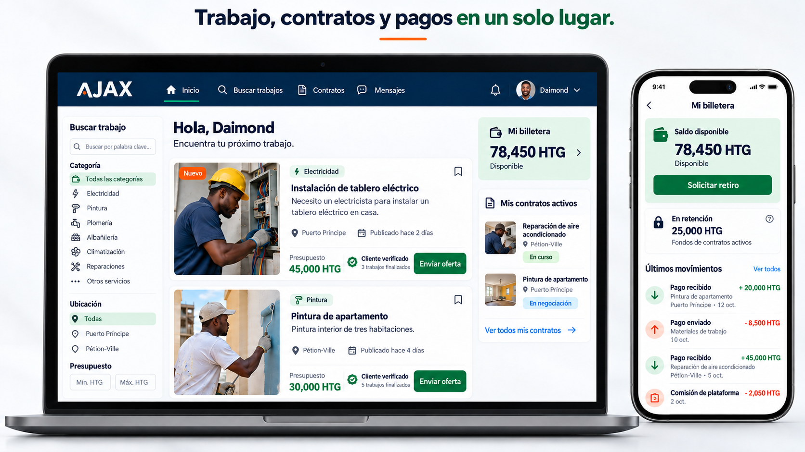

# Denizard François

### React & Java Developer · App Bug Fixes & API Integration

I help fix broken user flows and connect frontend interfaces with backend APIs in existing web apps. My focus is React, Java and Spring Boot: forms, authentication, permissions and business logic.

[Work with me on Upwork](https://www.upwork.com/freelancers/~01b412802d9016977f) · [AJAX case study](projects/ajax.md)

## How I can help

| Problem | Focus |
| --- | --- |
| A form does not save or shows the wrong state | Trace the request from React through API validation to the database |
| Login or a protected action fails | Investigate session handling, authentication and role checks |
| A screen needs real data | Connect the interface to REST APIs and handle loading, empty and error states |
| A business operation allows an invalid action | Review state transitions and backend rules |

## Featured project: AJAX

AJAX is my own service app connecting clients and professionals in Haiti. I developed much of the Java backend and use AI to accelerate development, with code review and validation of the affected behavior.

The project brings together job postings, offers, contracts, chat, notifications and held-payment and withdrawal workflows. It uses **React, Java 17, Spring Boot, MySQL, REST APIs and microservices**.

**[Read the technical case study →](projects/ajax.md)**

## Technical focus

- **Frontend:** React, JavaScript, responsive interfaces and API integration.
- **Backend:** Java, Spring Boot, REST APIs, authentication and business rules.
- **Data:** MySQL, SQL and versioned database migrations.
- **Additional experience:** Python and Next.js.

## Working approach

1. Reproduce the issue and define the expected behavior.
2. Trace the cause across the interface, API and data layer.
3. Agree on a focused change and review its impact.
4. Validate the affected flow and explain the result and remaining limits.

I use AI to support development, while keeping implementation decisions and review explicit.

## Communication

Spanish and French. I can read technical documentation in English.

**En español:** ayudo a corregir errores y completar funcionalidades en apps web con React y backend Java. Podemos empezar con un problema concreto, un alcance claro y una validación verificable.

**[Describe your app and the issue on Upwork →](https://www.upwork.com/freelancers/~01b412802d9016977f)**
