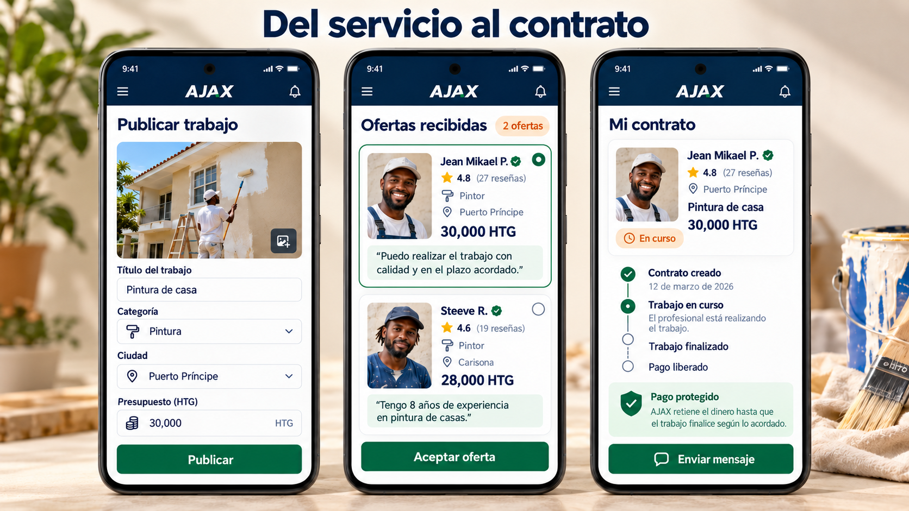

# AJAX — Service App

**Personal project · React · Java / Spring Boot · MySQL · REST APIs**

[Back to profile](../README.md) · [Contact on Upwork](https://www.upwork.com/freelancers/~01b412802d9016977f)

## The problem

Clients and professionals need a consistent journey from a job posting to an offer and contract. Each action depends on the user's role, the current business state and the data exchanged between services.

AJAX brings these workflows into a service app for Haiti. This case study describes the project and its engineering considerations. The source repository remains private.

## My contribution

I developed much of the Java backend and incorporated AI to accelerate development. The project connects a React interface to Java/Spring Boot services and MySQL databases through REST APIs and an API Gateway.

## Product workflows

| Area | Scope |
| --- | --- |
| Accounts | Clients, professionals and administrative roles |
| Jobs | Postings, offers and contracts |
| Communication | Chat and notifications |
| Payment domain | Held funds, wallet, withdrawal requests and disputes |
| Operations | Administrative review and activity tracking |

## Architecture

The React frontend communicates with backend APIs through a gateway. Java/Spring Boot services separate user accounts, professional profiles, postings, offers, payments, disputes, ratings, chat, notifications and files. MySQL stores application data, with Flyway migrations for schema changes.

The project also includes service discovery, centralized configuration and local infrastructure for file storage and development email.

## Engineering examples

### Roles and authorization

An action being hidden in the interface is not sufficient authorization. Backend checks must consider who is making a request and which resource or operation that user may access.

### Withdrawal states

A withdrawal request has a defined lifecycle, including pending, approved and paid states. Rejection also needs to handle the reserved balance. The important question is whether a transition is valid and leaves the data consistent, rather than simply whether an endpoint returns a successful response.

### Password recovery

The documented recovery flow uses expiring, single-use links, stores a hash of the token and returns the same response whether an account exists or not. This illustrates the edge cases that need review alongside the visible password-reset form.

## Validation

The source repository includes GitHub Actions workflows, backend tests, frontend tests and documentation for integration checks across authentication, contracts, disputes and withdrawals. Check results must be assessed on the relevant revision; the existence of tests alone does not establish production readiness.

## Product presentation

*Both images are AI-generated conceptual mockups in Spanish, prepared for product presentation.*

## Relevant client work

This project provides context for the types of scoped tasks I offer: debugging React/API integration, validating user permissions, completing forms and reviewing business-state transitions in existing apps.

[Discuss a focused task on Upwork →](https://www.upwork.com/freelancers/~01b412802d9016977f)
